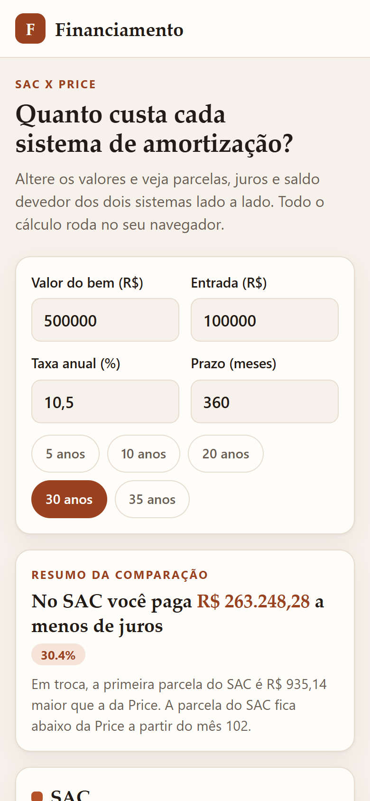
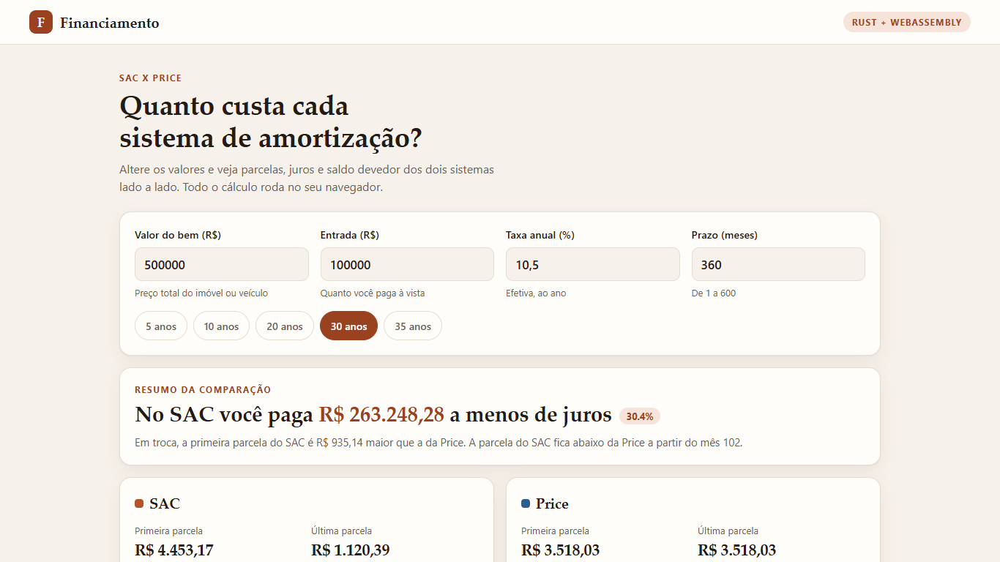

# Financing simulator — SAC vs Price

[](https://github.com/alissonlittig/financing-simulator-wasm/actions/workflows/ci.yml)

A loan simulator written in **Rust** and compiled to **WebAssembly**. It compares the two amortization systems used in Brazilian financing, **SAC** (constant amortization, falling payments) and **Price** (French system, constant payments), side by side.

**Live demo:** https://alissonlittig.github.io/financing-simulator-wasm/

| Mobile (390 px) | Desktop |
|---|---|
|  |  |

## What it does

- Inputs: asset price, down payment, effective annual rate, term (1–600 months), with input validation.
- Side-by-side summary: first/last payment, total interest and total paid for each system.
- A plain verdict: how much interest SAC saves, and the month when the SAC payment drops below the Price payment.
- Two SVG charts (monthly payment and outstanding balance), generated in Rust.
- Full amortization table (sticky header, scrollable) with a SAC / Price switch.
- CSV export of both schedules, built in the browser (no server).
- Light and dark themes (follows the OS), keyboard friendly, responsive down to 390 px.

## Stack

- Rust 2021, [Leptos 0.6](https://leptos.dev) (client-side rendering)
- [Trunk](https://trunkrs.dev) to build the WASM bundle
- Plain CSS, no JS framework
- GitHub Actions: `cargo test`, `trunk build --release`, deploy to GitHub Pages

## How the maths works

The annual effective rate `a` becomes a monthly rate `r = (1 + a)^(1/12) - 1`.

- **SAC:** amortization is `P / n` every month; interest is `balance * r`, so the payment falls over time. Total interest is `P * r * (n + 1) / 2`.
- **Price:** payment is `P * r / (1 - (1 + r)^-n)`, constant; interest dominates early on.

The last installment absorbs floating-point drift so the balance ends at exactly zero. The model is illustrative: no insurance, fees or inflation indexing.

## Project layout

```
src/lib.rs    pure calculation, formatting, CSV and SVG chart code + unit tests
src/main.rs   Leptos UI (components, signals, CSV download)
style.css     design tokens and layout
index.html    Trunk entry point
```

The calculation lives in a plain library crate so `cargo test` runs natively, without a browser.

## Run it

```bash
rustup target add wasm32-unknown-unknown
cargo install trunk --locked

cargo test            # unit tests
trunk serve --open    # dev server with live reload
trunk build --release # production bundle in dist/
```

## Tests

`cargo test` covers the reference Price payment (100k at 1%/month over 12 months = 8,884.88), the SAC interest closed formula, balance ending at zero, zero-rate loans, SAC/Price crossover, input validation, pt-BR currency formatting, CSV output and chart generation.

## License

MIT
